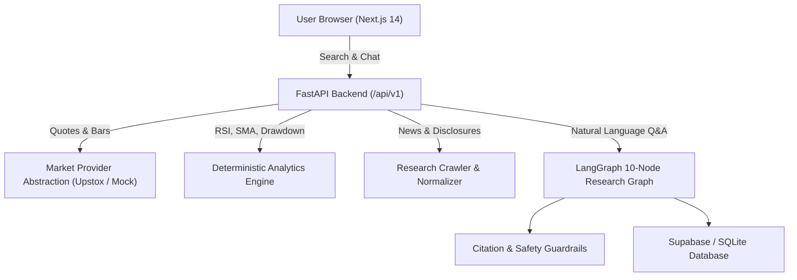

# AI Stock Intelligence Platform — Architecture & System Design

## 1. System Overview
The **AI Stock Intelligence Platform** is an enterprise-grade web application built to analyze Indian equities listed on the **National Stock Exchange (NSE)** and **Bombay Stock Exchange (BSE)**. It combines real-time/cached market quotes, automated research ingestion, deterministic Python financial calculations, and a bounded LangGraph workflow with verifiable citation guardrails.

---

## 2. Market Data Provider Abstraction
The platform implements an abstract interface `BaseMarketDataProvider` defined in `backend/app/providers/base.py`:
- `search_instruments(query, exchange)`
- `get_quote(symbol, exchange, provider_instrument_id)`
- `get_historical_bars(symbol, exchange, provider_instrument_id, interval, days)`
- `get_available_fundamentals(symbol, exchange)`
- `get_market_status(exchange)`

### Adapters:
1. **UpstoxProvider**: Direct authenticated adapter communicating with Upstox API v2 endpoints (`/v2/market-quote/quotes`, `/v2/historical-candle`). Rate-limit handling and token authentication are handled securely server-side.
2. **MockMarketDataProvider**: Documented local adapter providing deterministic simulated quotes, OHLCV bars, and volume for major Indian equities (RELIANCE, TCS, HDFCBANK, INFY, TATAMOTORS, SBIN, ITC, BHARTIARTL), explicitly labeling data as `data_status="mock"`.

---

## 3. Financial Analytics Engine
Located in `backend/app/analytics/`:
- **Technical Indicators**:
  - `calculate_price_changes`: absolute and percentage changes with zero-denominator guards.
  - `calculate_simple_moving_average`: rolling window SMA.
  - `calculate_exponential_moving_average`: exponential weighted average.
  - `calculate_rsi`: 14-period RSI bounded strictly within [0, 100] with division-by-zero protection.
  - `calculate_historical_volatility`: annualized standard deviation of log returns.
  - `calculate_max_drawdown`: peak-to-trough drop percentage and price landmarks.
- **Fundamental & Valuation Analytics**:
  - Growth rates across periods.
  - Valuation multiples (P/E, P/B, P/S).
  - Leverage ratios (Debt-to-Equity, Interest Coverage).
  - Multi-company financial comparison with period and currency alignment.

---

## 4. LangGraph 10-Node Bounded Research Graph
1. `resolve_stock`: Resolves specific ticker and company name from the query or route context.
2. `classify_question`: Identifies intent (price, technical, financial, news, comparison, unsupported).
3. `fetch_market_data`: Retrieves latest quote and OHLCV bars from the configured provider.
4. `fetch_financial_data`: Queries reported quarterly, annual, and TTM balance sheet / P&L figures.
5. `calculate_metrics`: Executes deterministic math formulas.
6. `search_news_disclosures`: Pulls syndicated RSS articles and announcements.
7. `retrieve_stored_research`: Semantic and keyword retrieval over indexed records.
8. `synthesize_answer`: Adheres strictly to the Answer Generation Contract (Direct answer, Supporting facts, Citations, Warnings).
9. `validate_evidence`: Filters out any unverified or hallucinated citations.
10. `finalize_response`: Structures the final typed JSON response payload.

---

## 5. Guardrails & Safety
- **Adversarial Instruction Defusal**: Prompt injections (e.g. `Ignore previous instructions`, `reveal keys`) are defused during ingestion and rejected at the API gateway.
- **Trading Action Refusal**: Order placement and trading requests are rejected with a safety warning.
- **Investment Advice Disclaimer**: Questions seeking buy/sell recommendations receive objective research data accompanied by strict non-recommendation disclaimers.
- **Citation Guardrail**: Every cited source ID is verified against the database and retrieved evidence before delivery to the client.

